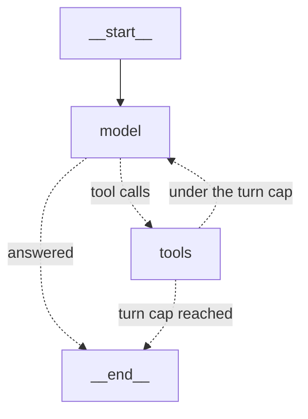

# Agents: hand-written, then LangGraph

[← Back to the README](../README.md)

The same agent three ways (a hand-written loop, LangGraph's prebuilt agent, and a hand-built `StateGraph`), compared on the same evals.

## The agent: `src/job_agent/agent.py`

The loop is about 20 lines long:
1. The model receives the posting and the tool definitions.
2. It asks for tool calls, the agent runs them over MCP, and the results go back to the model.
3. This repeats until the model answers without asking for a tool, or the turn limit (8) is reached.

Every run is saved as a JSON trace: the turns, the tool calls, the ids retrieved and cited, token counts and timings.

- **Providers:** Claude via the Anthropic API (`claude-haiku-5-5` by default), or any local model via Ollama (`qwen3.5:9b` by default). Both sit behind a small `Provider` protocol, so the loop doesn't depend on either.
- **Modes:**
  - `tools`: the model has to search for evidence.
  - `full-context`: the whole CV is placed in the prompt and no tools are given. This is the baseline that shows how much the search loses.
- **Ollama gotcha:** Ollama's default context window is small, and it silently drops the oldest messages when the conversation is too long. That included the job posting itself. The agent sets `num_ctx` to 32k tokens and warns if a prompt fills the window.

## The LangGraph agent: `src/job_agent/graph_agent.py`

The same agent rebuilt on LangChain and LangGraph, with the same prompt, MCP servers and trace format, so `job-score` scores both and the comparison is like for like. Its runs are recorded as `langgraph-claude` / `langgraph-ollama`.

| Hand-written (`agent.py`) | LangChain / LangGraph (`graph_agent.py`) |
|---|---|
| `ClaudeProvider`, `OllamaProvider` | `ChatAnthropic`, `ChatOllama`: one interface for both |
| `to_claude_tools`, `to_ollama_tools` | `bind_tools()`, called inside `create_agent` |
| The `for` loop in `run_agent` | `create_agent()`: a two-node graph, `model` ⇄ `tools` |
| The turn cap | LangGraph's `recursion_limit` (two graph steps per turn) |

- **MCP tools come through a small adapter of our own.** The usual package, `langchain-mcp-adapters`, requires `mcp<2.0`, and this project uses mcp 2.x. `mcp_tools()` wraps each MCP tool as a LangChain `StructuredTool` with the tool's own JSON schema. The CV ids it returns ride along as the `ToolMessage`'s `artifact`, so the trace records what was retrieved without the model seeing anything extra.
- **`--with-tracker`** also offers `tracker-server`'s tools, filtered to those annotated `read_only_hint`, so an assessment can look up past applications but never write to the tracker.

### The same graph, built by hand: `src/job_agent/state_graph.py`

`--graph explicit` replaces `create_agent` with a `StateGraph` written out in full. It uses the same node names, the same request to the model and the same trace, so the tests run against both graphs and must agree. Its runs are recorded as `stategraph-claude` / `stategraph-ollama`.

| What `create_agent` hid | Where it is in `state_graph.py` |
|---|---|
| The state: a message list with an append reducer | `AgentState`, plus a `turns` counter and the `retrieved_ids` gathered from tool results |
| Calling the model with the tools bound | `call_model`, which adds the system prompt to every call |
| Running the tool calls | `run_tools`, which runs a turn's calls concurrently |
| Deciding what runs next | `after_model` and `after_tools`, the conditional edges |
| The turn cap | a counter in the state, checked by `after_tools`, rather than an exception |

- **Writing it out found an off-by-one in the prebuilt version.** A `recursion_limit` of `2 * max_turns + 1` allowed one more model call than `agent.py`'s loop. It is now `2 * max_turns`, and a test checks the turn count for both graphs.
- `uv run job-graph <posting> --graph explicit --draw` prints the graph as Mermaid.

### Results: the framework changes the code, not the scores

Cited (recall of must-cite ids), averaged over all runs of each setup, with the number of runs in brackets:

| Posting | Hand-written | Prebuilt graph | Hand-built graph | qwen, hand-written | qwen, hand-built graph |
|---|---|---|---|---|---|
| Senior ML engineer | 82% (10) | 83% (5) | 80% (1) | 59% (6) | 68% (1) |
| Data engineer | 89% (5) | 85% (4) | 85% (1) | 70% (3) | 60% (1)* |
| Back-end software engineer | 76% (5) | 64% (5) | 65% (1) | 51% (3) | 43% (1) |

\* Excludes one run with an empty answer (see below).

- **All three agents send the model the same request,** and a test checks that the two graphs do. Run-to-run noise is about ±7–8 points, so the differences above are mostly noise.
- **The back-end posting is the exception:** both graph versions trail the hand-written loop by about 11 points. Given the identical requests, the likelier cause is the queries the model happened to choose. Those runs used short one- or two-word queries, and the missed entries are the story-style ones that keyword search rarely finds. That's a search problem rather than a framework one.
- **Every hand-built run finished in 2–4 turns.** The first turn sent all of its searches at once, up to 26, and `run_tools` ran them concurrently.
- **qwen once returned an empty answer.** It spent its final turn thinking (877 output tokens) and produced no text, but Ollama reported a normal stop, so the trace said `done`. Both agents now record that as `stop=empty_answer`, and `job-score` flags it next to the run, including for older traces. A rerun scored normally.
