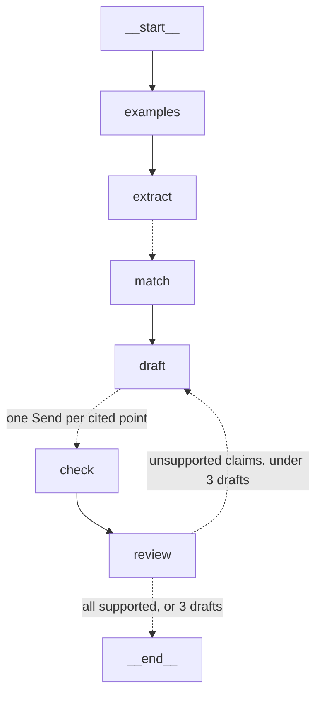

# Cover letter plans and tailored CVs

[← Back to the README](../README.md)

Drafting from the matched evidence, checking every point against the entries it cites, and fixing what fails without losing what passed.

## Cover letter plans: `src/job_agent/letter.py`

The pipeline's matches feed a planner, and every cited point in the plan is checked against the entries it cites before the plan is accepted. The output is a plan to write the letter from, not the letter. For each paragraph, it gives a sentence on what the paragraph should be about and why, then suggested points, each with its citations:

```markdown
## 2. NLP in production

*Show that you've taken ML from research to a live service, which is the core of this role.*

- I took sole technical ownership of turning a research NLP model into a hospital-wide production system [cv-004].
- ...
```



| Node | What it does |
|---|---|
| `examples` | Picks up to 2 cover letters from past applications that reached interview or offer, using the tracker's status history, as examples of tone and structure |
| `extract`, `match` | The pipeline's nodes, reused unchanged |
| `draft` | Plans 4–5 paragraphs with structured output from the verdicts and the matched entries' text only. Each paragraph has a title, a purpose and points; each point has its text and its `cv_ids`. Code then gives every point a stable id (`p1`, `p2`, …). On a redraft, the model sees only the failed points and their problems, and returns a fix or a drop for each. Code applies them, so points that passed can't be changed or lost |
| `check` | One branch per new or changed point, cited or not; unchanged points keep their verdict. A cited point: does it say only what its entries say? The entry text comes from cv-server's `cv://entry/{id}` resource, and an id that isn't a CV entry fails without a model call. An uncited point: does it state any fact about you? Motivation passes; an uncited fact fails |
| `review` | Joins the checks. The router sends the plan back to `draft` with the failures, or ends |

- **The graph has a cycle,** `review → draft`, bounded by an `attempt` counter in the state (at most 3 drafts). If claims still fail after that, the run ends with a warning that lists them, rather than looping or quietly dropping them.
- **Checks build up across rounds,** because the `checks` field's reducer adds to the list. Each check records which draft it was for, so `review` looks only at the current one.
- **The model proposes changes; code applies them.** At first a redraft asked the model to rewrite the whole plan, fixing only the flagged points. qwen returned just the paragraph it was fixing, so a 12-point plan became 2 points, every one of which passed, and the run was reported as verified. Now the plan lives in the state, and a redraft returns only `{id, text, cv_ids}` or `{id, drop}` for the failed points. Fixes to points that passed are ignored. Dropped points are listed in the summary, so a shrinking plan is visible, and a redraft re-checks only what changed.
- **Output:** the plan, citations kept, goes to `data/drafts/<posting>.cover_letter_plan.md`. Any points still unsupported after 3 drafts are listed at the end of that file, so you can't miss them. A trace of each draft's points and failures goes to `data/evals/letters/<posting>.jsonl`.

### Checking the checker: `job-verify-eval`

The loop is only as good as its checker, and recall and precision can't see a false claim that cites a valid id. `data/evals/claims.yaml` holds hand-labelled claims: the real mistakes the pipeline made (the wrong employer, AWS CDK, VPC "implied") and written variants (inflated numbers, a personal project presented as work, "working towards" a certification presented as "certified"), plus correct claims about the same entries, and uncited points of both kinds (facts and motivation).

| Checker | Unsupported claims caught | Supported claims wrongly flagged |
|---|---|---|
| Claude Haiku (4 runs, 32 claims) | 14–15/15 | 0/17 in every run |
| qwen3.5:9b, thinking off (32 claims) | 15/15 | 3/17 |

Claude's one miss, in 3 of 4 runs, is the merged-projects claim below. qwen catches everything but flags true claims: motivation, a sentence that leaves out a detail, and the employer's own facts. That's why Claude checks.

The claims include points from a real qwen plan that qwen's own checker flagged, checked by hand: two of its flags were correct, two were false alarms.

- **Citations have to be part of the schema, not just a rule in the prompt.** With citations written into the text as `[cv-012]`, qwen (thinking off) wrote real evidence with no citations at all. Only cited points were checked then, so its plan was marked verified with nothing checked. Now each point has a `cv_ids` field, every point is checked, and a run with nothing checked is reported as "NOTHING CHECKED", never "VERIFIED".
- **The verdict comes after the reasoning.** With `supported` as the first field, Claude once committed to "false" and then argued itself back to "supported" in its explanation, so a true claim was flagged. Putting a `reasoning` field first fixed it. Structured output is generated in field order, so field order is part of the prompt.
- **A small checker is too strict, and the loop can't settle.** With qwen checking qwen's plan, unsupported points went from 11 to 6 to 4 over 3 drafts. It made real catches ("led" a project you joined; "open-source" when the entry doesn't say so), but about half of its late flags were false alarms, and it wrote pages of working into the `problem` field. A run took about 16 minutes. The checker can now be a different model (`--checker claude`): planning stays local and checking goes to the stronger model. Checks are small calls, but they're where accuracy matters most. The problem field is cut to its first line, so working doesn't get fed back to the planner.
- **Merging two projects is a claim too.** "I worked with the patient feedback team… and fixed bugs while supporting clinicians" cites two real entries, but from two different projects. Each fact is supported and the sentence still misleads. Claude missed this until the check prompt said so explicitly, and it's still the one claim it usually misses (3 runs in 4). It is the checker's known weak spot.
- **Facts about the employer aren't claims about you.** "…help close the gap between your capacity and customer demand in Manchester" was flagged because no CV entry mentions Manchester. The check prompt now says that only facts about the user need support.
- **A fixer will take the easy way out.** Asked to fix 7 points, qwen dropped all 7, which removed the closing paragraph, and the plan passed. Told to make the smallest change that makes a point true, and to drop only if nothing true remains, it fixed 7 and dropped none, and the next draft fixed 4 more. Unsupported points went 8, 4, 2, with all 15 points kept. Any paragraph emptied by drops is reported, and dropped points are listed at the end of the plan file.
- **Ids are cleaned in code.** qwen fills a required `cv_ids` with `[""]` for "none", or writes `cv-31`. Those are normalised before checking, rather than failing as unknown entries.

**On postings not used for tuning.** Every prompt fix above came from Found Health runs. Two final runs on the other postings:

| Posting | Planner → checker | Unsupported per draft | Points | Result |
|---|---|---|---|---|
| Senior ML engineer | Claude → Claude | 2, 1, 0 | 18 kept, 0 dropped | Verified, about 35 s |
| Data engineer | qwen → Claude | 9, 3, 1 | 13 of 14 kept, 1 dropped | 1 point unsupported, listed in the plan, about 5 min |

Claude's plan is specific, and it names the gaps honestly (no CDK or CloudFormation, no formal TDD) instead of presenting them as strengths. qwen's first draft adds details your CV doesn't contain ("auditable", "federated", "SQL optimisation", "sole technical ownership"). The checker catches them and qwen fixes them, but its points are vaguer afterwards. The one point left unsupported is a correct catch: two projects merged into one tool.

## Tailored CVs: `src/job_agent/cv.py`

The same graph as the letter plan (extract, match, draft, check each point, fix by patching), applied to your own CV as a Word template. Three settings change, through `letter.Drafting`:

| | Letter plan | CV |
|---|---|---|
| Sections | 4–5 paragraphs the model chooses | Profile, Key Skills, then one section per job in the template |
| Evidence shown | The matched entries | Every entry, grouped by the job it belongs to, so every job gets bullets whatever the posting asks for |
| Allowed citations | Any entry | **A job's bullets may cite only that job's entries.** This is checked in code, without a model call, so work can't move to the wrong employer |

- **Facts are never generated.** The name, contact line, job titles and dates, education, publications and projects are left exactly as they are in the template. Only the profile, the skills lines and each job's bullets are replaced, and the template's own paragraphs are cloned, so fonts, bold category labels and bullet styles carry over.
- **The CV stays the same length.** The prompt gives each job's current bullet count. Without it, the first run wrote 9 bullets for a job the template gives 6, making the CV about a third longer.
- **Inputs are personal and stay in `data/`:** `cv_template.docx` (your CV), and `cv_employers.yaml`, which says which job each CV entry belongs to and how each job's header reads in the template. The employer of each entry was suggested from its text and then reviewed by hand: 17 of the 78 couldn't be told from the text alone.
- **Output:** `data/drafts/<posting>.cv.docx`, plus `<posting>.cv_plan.md` with every bullet's citations, for checking.

On the senior ML engineer posting with Claude: 22 points, unsupported 4, then 1, then 0 over 3 drafts, with nothing dropped. The checker refused to call unit testing "TDD", and stopped mentoring that one entry credits to a researcher from being credited to analysts as well.
