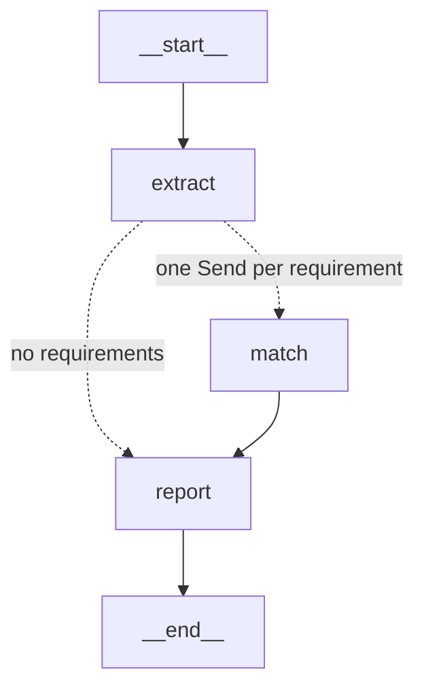

# The assessment pipeline

[← Back to the README](../README.md)

Splitting the assessment into steps (extract the requirements, match each one in parallel, report) and what that did for Claude and for a small local model.

## The pipeline: `src/job_agent/pipeline.py`

The same assessment as a multi-step graph. The agent no longer chooses its searches in one big turn: each step has one job.

| Node | What it does |
|---|---|
| `extract` | One model call with **structured output**: the posting's requirements as a validated Pydantic list, each with 2–4 search queries (the skill, a synonym, and an outcome or story that would show it) |
| `match` | Runs once per requirement, **in parallel** (LangGraph's `Send`). It runs that requirement's searches, then one structured-output call judges met / partly / gap and lists the supporting ids |
| `report` | No model call: writes the verdicts up as the assessment, in the posting's order |

- **The branches' results are merged by a reducer.** Every `match` branch writes to `matches` in the same step, so the field is `Annotated[list, operator.add]`. Without the reducer, LangGraph raises an error rather than keep one branch's value.
- **Each judge sees only its requirement's evidence,** which keeps prompts small, and an id it cites without being shown shows up as made-up in `job-score`.
- **A step that fails to parse doesn't stop the run.** `include_raw=True` returns the error instead of raising it, and the requirement is reported as "Not judged".
- Runs are recorded as `pipeline-claude` / `pipeline-ollama`.

### Results: splitting the work up finds more evidence

Claude Haiku, 3 runs per posting:

| Posting | Single agent (hand-written), cited | Pipeline: retrieved / cited / precision |
|---|---|---|
| Senior ML engineer | 82% (10 runs) | 96% / 88% / 91% |
| Data engineer | 89% (5 runs) | 93% / 92% / 88% |
| Back-end software engineer | 76% (5 runs) | 94% / 86% / 77% |

- **Searching per requirement finds more.** Retrieval is 93–96% on every posting. Each requirement gets 2–4 queries written for it, including the kind of story that would show it ("sole ownership", "picked up quickly"), and those find the story-style entries a single search turn missed.
- **The extractor decides what gets judged.** On its first run, the back-end posting scored 65% cited. The extractor had only listed skills from the posting's bullet points. It missed requirements stated in prose (integrating fragmented systems, learning an unfamiliar stack), and it turned "you don't need to know our stack" into "Node.js: not met". A requirement that isn't extracted is never searched for or judged. Telling the extractor to read the prose took that posting to 86%. The single agent can notice a gap partway through; the pipeline can't, so the extraction prompt matters most.
- **Logistics have to be excluded explicitly.** The prose rule pulled "hybrid working in the office" back in, judged as "not met". A rule that comes first and applies wherever the posting mentions logistics fixed that.
- **Precision is lower: 77–91%, against 92–96% for the single agent.** The pipeline extracts 14–18 requirements, against 7–10 in the answer keys. Evidence for the extra ones (mentoring, code review, degree) counts against precision even when it's apt. That's partly an answer-key review to do, as before.
- **Valid citations can still back false claims.** One report said credentials were secured with Vault "at BBC", but the cited entry is from a different employer. Recall and precision can't catch that, because the id is valid. Checking each claim against the entry it cites is the next step: a verifier.
- **Cost:** 15–19 model calls and about 45–57k input tokens per run, against 2 calls and 16–25k tokens. Each call is small, and the matches run in parallel.

**With the local model** (qwen3.5:9b, one or two runs per setup, so indicative only):

| Posting | Single agent, thinking on | Single agent, thinking off | Pipeline, thinking off |
|---|---|---|---|
| Senior ML engineer | 59% | 56% | 84% |
| Data engineer | 70% | 60% | 85% |
| Back-end software engineer | 51% | 35% | 74% |

(cited. Thinking on: the hand-written loop, `job-agent`, 3–6 runs per posting. Thinking off: the hand-built graph, `job-graph --graph explicit --no-think`, which sends the same request.)

- **The pipeline suits the small model.** qwen's weakness was judgement, not search. One requirement and its own evidence at a time is a much smaller decision than a whole assessment, and the gap to Claude narrows from about 23 points to about 7.
- **The pipeline does the planning, so the model doesn't have to think.** Turning thinking off makes the single agent worse: it searches less (43–72% retrieved) and cites 3–16 points less. With thinking off in both setups, the pipeline beats the single agent by 25–39 points. The extractor writes the searches, which leaves the small model only the judging.
- **Thinking is the cost on a local model.** With thinking on, each call took about 4 minutes, and runs failed when Ollama dropped queued requests. With `--no-think` a whole posting takes about 100 seconds. The pipeline also sends Ollama one request at a time (`--max-concurrency`, default 1 for Ollama) and retries a dropped connection (LangGraph's `RetryPolicy`) instead of failing the run.
- **Its claims need checking more than Claude's.** Examples: "AWS CDK was used (cv-018)" when cv-018 is SageMaker; VPC experience "implied"; "machine learning fundamentals: gap" despite clear evidence. Each cites a valid id, so the scores don't see them. The verifier step is for these.
