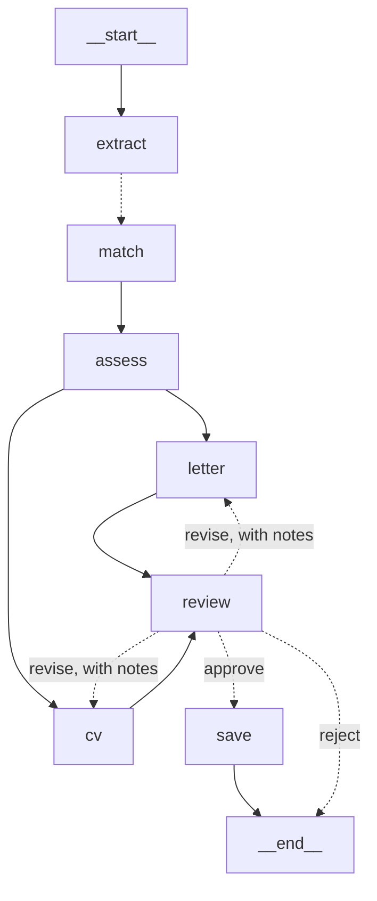

# Approval workflow and web API

[← Back to the README](../README.md)

One run per posting that pauses for your decision before anything is saved, and the HTTP API over it.

## Applying, with your approval: `src/job_agent/workflow/`

`job-apply` runs everything for one posting, then **stops and waits for you** before writing anything to the tracker.

- **Matched once, drafted in parallel.** The letter plan and the CV share one assessment. The letter graph skips extract and match when it's given one, and the two run side by side.
- **`interrupt()` pauses the run at `review`.** It shows the verdict counts, and for each document whether it verified, how many drafts it took and where the file is. You can approve, revise with notes (for the letter, the CV or both; only those are redrafted, checked and shown again), or reject.
- **A SQLite checkpointer (`data/runs.db`) saves every step.** A paused run can be left: `job-apply --resume <run>` picks it up from the review in a new terminal or the next day, without drafting anything again. A run that fails part-way (a dropped model connection, say) resumes from its last completed step. The checkpointer only loads the project's own types (`Requirement`, `Turn`) besides LangGraph's, so a tampered database can't make it build arbitrary objects.
- **The only writes come after approval.** `save` logs the application (status `interested`, linked to the posting) and saves the assessment, the letter plan and the CV plan as drafts, with the `.docx` path noted. Rejecting writes nothing.
- **Layers:** `graph.py` (LangGraph), `service.py` (`start`, `decide`, `retry`, `view`, `runs`: the only entry point), `models.py` (Pydantic `Review`, `Decision`, `RunView`, with no LangGraph types), `cli.py`. The web interface will use the same service.

## The web API: `src/job_agent/web/`

`uv run job-web` serves the apply workflow over HTTP on `http://127.0.0.1:8000`, with interactive docs at `/docs`. It's the backend for the React app (next).

| Endpoint | What it does |
|---|---|
| `GET/POST /api/postings`, `GET /api/postings/{name}` | List, save (pasted text with company, role and URL) and read postings, using the same rules as `--clipboard` |
| `POST /api/runs` | Start a run. **Returns at once (202)**; the run continues in the background |
| `GET /api/runs`, `GET /api/runs/{id}` | Runs and their status, with the review when one is paused |
| `GET /api/runs/{id}/events` | **Live progress** as server-sent events, then the final status |
| `POST /api/runs/{id}/decision` | Approve, revise (with notes) or reject; also runs in the background |
| `POST /api/runs/{id}/retry` | Carry on a run that stopped part-way, from its last saved step |
| `GET /api/runs/{id}/files/{kind}` | Download the letter plan, the CV plan or the `.docx` |

- **The routes hold no workflow logic.** They validate, call the run manager (which calls `ApplyService`), and return the workflow's own Pydantic models. The OpenAPI schema therefore describes exactly what the frontend gets, and its TypeScript types will be generated from it.
- **Runs never block a request.** Each run is a background task. Its state is always read from the checkpointer, so runs started from `job-apply` show up too, and a restart loses nothing. A run that fails part-way is reported as `stopped` with the reason, and `retry` carries on from its last completed step.
- **Progress goes to the right run.** Each run's graph is tagged with its id (a context variable), so a progress line is delivered only to pages following that run, with the backlog first for a page opened part-way through.
- **Clear errors:** 404 for an unknown run or posting; 409 for a decision on a run that isn't paused, or a second run of a posting already in progress; 422 for an invalid name or decision.
- **Local and locked down.** It listens on `127.0.0.1` only, and there's deliberately no option to change that, since there's no login yet. CORS allows only the React dev server. Downloads are chosen by kind and built from the run's own posting name, never from a path in the request, and nothing in `data/` is served directly.
